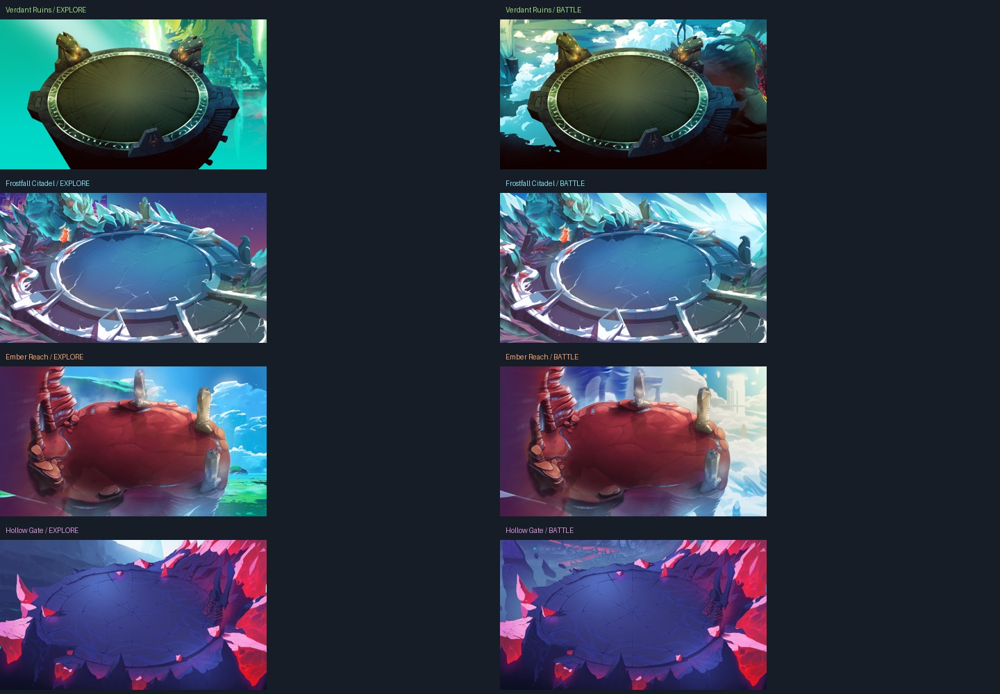
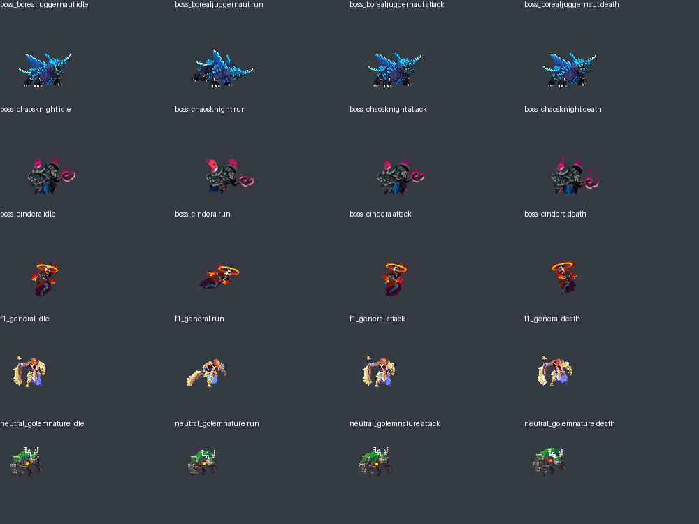

# Environments and animation assets

Research and downloads completed on 15 October 2026. Art source: [OpenDuelyst](https://github.com/open-duelyst/duelyst), commit `2843f2400854136598631288c2e8dfb8f5173de7`. License: **CC0 1.0**, verified against the repository's root LICENSE and included locally. This is an existing hand-painted fantasy game asset collection, not newly generated artwork.

## Four playable environments

Each region uses three distinct local images: an exploration panorama, a battle panorama, and a transparent painted ground platform. The game places the hero and opponents on the actual ground art. The walking area is constrained to its central surface.

| Game region | Exploration panorama in upstream `app/resources/scenes/` | Battle panorama in upstream `app/resources/maps/` | Painted floor |
|---|---|---|---|
| Verdant Ruins | `shimzar/bg.jpg` | `shimzar/background.jpg` | `shimzar/midground.png` |
| Frostfall Citadel | `frostfire/background.jpg` | `vanar/background.jpg` | `vanar/midground.png` |
| Ember Reach | `magaari_ember_highlands/magaari_ember_highlands_background.jpg` | `redrock/background.jpg` | `redrock/midground.png` |
| Hollow Gate | `obsidian_woods/obsidian_woods_background.jpg` | `abyssian/background.jpg` | `abyssian/midground.png` |

The region names are original labels for this educational game. They do not imply that the original game paired those exploration scenes with those arenas.



Every chosen background and floor was visually inspected, including transparency and composition. The platforms are separate real source images; they are not flat generated shapes or repeated synthetic textures. Exploration and battle use the same region's floor to make the transition understandable, with a changed backdrop and camera treatment.

## Actual animation frames

All five actors come from upstream `app/resources/units/`. PNG atlases and original Cocos metadata are bundled, with a converted Phaser JSON atlas. These are real frame sequences, not static characters moved by CSS.

| Actor | Role | Idle | Run | Attack | Cast | Hit | Death |
|---|---|---:|---:|---:|---:|---:|---:|
| `f1_general` | Hero | 11 | 8 | 23 | 12 | 3 | 12 |
| `neutral_golemnature` | Verdant guardian | 12 | 8 | 8 | attack fallback | 3 | 9 |
| `boss_borealjuggernaut` | Frost guardian | 16 | 8 | 26 | attack fallback | 3 | 21 |
| `boss_cindera` | Ember guardian | 12 | 8 | 40 | attack fallback | 3 | 27 |
| `boss_chaosknight` | Final guardian | 16 | 10 | 39 | attack fallback | 3 | 25 |

For enemies, `cast` intentionally refers to their own attack frames because the source actor does not contain a separate cast animation. The hero has a separate original cast sequence. The atlas also preserves other original groups such as breathing.



## Runtime format

`public/assets/manifest.json` is the loader contract:

```text
hero, enemies[]:
  key, image, atlas, animations, fps, scale, origin
biomes[]:
  id, name, subtitle, background, battleBackground, ground,
  accent, enemyKey, walkBounds
```

All paths are relative to the web root. Each `animations` entry contains an ordered list of original frame names. `origin.y` represents the measured feet position within the transparent source canvas; use it to avoid a character's feet floating above its shadow. `walkBounds` describes a normalized ellipse on the platform.

The five atlases were inspected for source geometry: all frames are currently unrotated and have equal untrimmed canvas size within each actor. The converter still preserves trimming and rotation fields.

## Rebuilding the asset conversion

The playable game already includes the converted images and JSON. Players do not need Python or network access to load these assets.

For maintainers who want to reproduce the import:

1. With Python 3 and Pillow available, run `python tools/download_assets.py`.
2. Run `python tools/download_exploration.py`.
3. Run `python tools/convert_assets.py`.

The download tools use only pinned raw GitHub source paths. The source record contains a SHA-256 for every original downloaded file. `THIRD_PARTY_NOTICES.md` describes the modifications.
